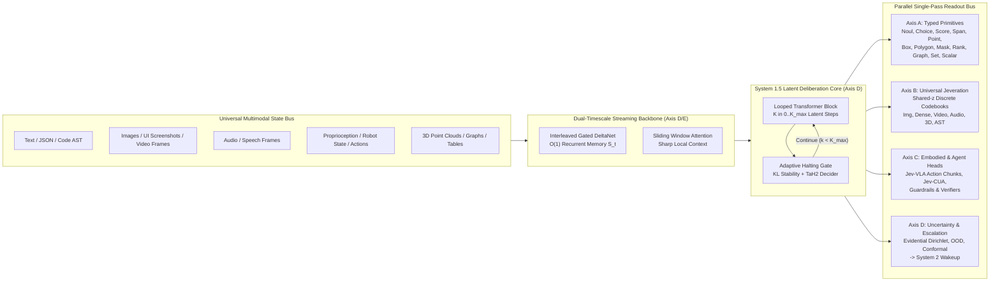

# 01 — Unified OmniJev Architecture & Axis A Typed Primitives

## 1. Design Philosophy: One Unified State-to-Decision-to-Generation Paradigm

Original **Jev** (TypeSafe AI, Sep 2026) proved that eliminating the autoregressive decoding loop yields 40×–200× latency speedups and schema-guaranteed, calibrated outputs for structured judgments (`Noul`, `Choice`, `Score`, and `Box` in `jev-1.14`). **Jeveration** (`arXiv:2611.24738`, Nov 2026) then proved that injecting a **shared random state** over **discrete latent codes** lets a single forward pass perform globally coherent multimodal *generation* as well.

However, deploying isolated specialist models for classification, extraction, grounding, robotics, audio, video, and reasoning fragments infrastructure and throws away shared cross-modal world understanding.

**OmniJev** unifies all five capability axes (**A–E**) into a single modular architecture family built around four invariant stages:

### Core Architectural Invariants
1. **Encode Once, Query Many (`O(1)` State Reuse):** The multimodal state $\mathbf{X}$ is encoded once into a shared contextual representation $\mathbf{H} \in \mathbb{R}^{B \times L \times D}$ (plus spatial feature pyramid $\mathbf{F}_{\text{2D}} \in \mathbb{R}^{B \times C \times H_f \times W_f}$ for vision/UI and persistent recurrent memory $\mathbf{S}_t$ for streaming). Any number of typed, generative, or action queries can read from $\mathbf{H}$ in parallel in the same forward pass.
2. **Zero Autoregressive Tax by Default:** Every primitive in Axis A, every single-pass generator in Axis B, and every control/grounding head in Axis C runs without token-by-token decoding.
3. **Adaptive Compute Without Text Bloat (System 1 $\leftrightarrow$ System 1.5 $\leftrightarrow$ System 2):** Simple decisions exit at $K=0$ latent loops (pure System 1); multi-hop relational tasks run $K \in \{1,\dots,K_{\max}\}$ internal latent steps (System 1.5); only genuinely out-of-inventory, high-epistemic-uncertainty, or open-ended prose tasks escalate to a System 2 LLM.
4. **Architectural Calibration & Invariance:** Position/order bias in `Choice` and `Rank` is eliminated by **architectural construction** (not $K\times$ rotation inference overhead), and uncertainty is decomposed into **aleatoric** vs. **epistemic** components everywhere.

---

## 2. Universal Multimodal State Bus

Every domain is tokenized into a uniform latent sequence $\mathbf{E} \in \mathbb{R}^{B \times L \times D}$ tagged with modality IDs, temporal timestamps $\tau_i$, and optional 2D/3D spatial coordinates $(x_i, y_i, z_i)$ via **Multimodal Rotary Position Embeddings (M-RoPE)**:

| Domain / Modality | Input Encoder | Token Representation | Spatial / Structural Side-Channel |
| :--- | :--- | :--- | :--- |
| **Text / JSON / Logs** | BPE Subword Embedding + Schema-Path Type Embeddings | $\mathbf{E}_{\text{text}} \in \mathbb{R}^{L_t \times D}$ | Token char-offset map for exact `Span` extraction |
| **Code / AST** | Subword + AST Node-Type & Depth Embeddings | $\mathbf{E}_{\text{code}} \in \mathbb{R}^{L_c \times D}$ | Parent/sibling edge adjacency for `Graph` & AST slot masks |
| **Images / UI / Video** | SigLIP-2 / ViT-NaViT Dynamic-Resolution Patch Encoder + 2D Pixel-Shuffle Merger | $\mathbf{E}_{\text{vis}} \in \mathbb{R}^{L_v \times D}$ | Multi-scale 2D feature pyramid $\mathbf{F}_{\text{2D}}$ for `Point`/`Box`/`Polygon`/`Mask` |
| **Audio / Speech** | Mel-Spectrogram / Mimi-Encoder Conv-Transformer (12.5–50 Hz frames) | $\mathbf{E}_{\text{aud}} \in \mathbb{R}^{L_a \times D}$ | Frame timestamp map $\tau_i$ for temporal `Span` & streaming |
| **Robotics / Control** | Proprioceptive MLP (joint pos/vel, gripper, wrench, IMU) + Goal Embedder | $\mathbf{E}_{\text{rob}} \in \mathbb{R}^{L_r \times D}$ | Continuous state vector $\mathbf{s}_{\text{prop}}$ skip-connected to VLA head |
| **3D / Spatial** | PointNet++ / Sparse Voxel / Triplane Patch Tokenizer | $\mathbf{E}_{\text{3d}} \in \mathbb{R}^{L_{3d} \times D}$ | Metric 3D coordinates $(x, y, z)$ in 3D-RoPE |
| **Tables / Graphs** | Row/Column Header + Node/Edge Attribute Encoders | $\mathbf{E}_{\text{graph}} \in \mathbb{R}^{N \times D}$ | Node index map for parallel `Rank` / `Graph` readout |

---

## 3. Complete Specification of Axis A Typed Primitives

Every primitive takes the deliberated shared state $\mathbf{H} \in \mathbb{R}^{B \times L \times D}$ (and for visual/spatial tasks, the 2D spatial grid $\mathbf{F}_{\text{2D}} \in \mathbb{R}^{B \times D \times H_f \times W_f}$) plus a task query embedding $\mathbf{q} \in \mathbb{R}^{B \times D}$ produced by cross-attending the question instruction over $\mathbf{H}$.

### Primitive Summary Matrix

| # | Primitive | Output Type / Space | Core Architectural Mechanism | Primary Training Loss |
| :--- | :--- | :--- | :--- | :--- |
| **A1** | **`Noul`** | $p \in [0, 1]$ + epistemic vacuity | Evidential Beta/Dirichlet binary head (2 concentrations $\alpha_+, \alpha_-$) | Evidential Log-Loss + Brier + ECE |
| **A2** | **`Choice`** | $\mathbf{p} \in \Delta^{C-1}$, winner, confidence, OOI prob | **Order-Invariant Set-Attention Option Encoder** + Bilinear Query-Option Matcher + Null/OOI Sink | RLCD + Evidential Dirichlet + OOI Negatives |
| **A3** | **`Score`** | Expected $s \in [0, 1]$, ordinal probs $\Delta^{M-1}$ | Cumulative Ordinal Link (CORAL / Ordered Logits with monotonic thresholds $\theta_1 < \dots < \theta_{M-1}$) | Cumulative BCE + Earth Mover's Distance (EMD) |
| **A4** | **`Span`** | `[start, end]` indices + top-$k$ spans + `no_span` prob | Biaffine Start–End Joint Scoring Matrix $\mathbf{S}_{ij}$ with upper-triangular valid mask ($i \le j$) | Joint Span Cross-Entropy + Focal Null Loss |
| **A5** | **`Point`** | $(x, y) \in [0, 1]^2$, multi-mode peaks, confidence | **SimCC (1D X/Y Marginal Logits) + 2D Spatial Softmax Heatmap** with Mixture-Peak Extractor | KL Divergence to 2D Gaussian Target + Coordinate L1 |
| **A6** | **`Box`** | `(top, left, bottom, right)` $\in [0, 1]^4$ + confidence | Query-to-2D Cross-Attention + Anchor-Free Center+WH / 4-Side SimCC Distribution Head | GIoU Loss + L1 + Focal Confidence + DFL |
| **A7** | **`Polygon`** | Ordered vertices $\{(x_v, y_v)\}_{v=1}^V$ + vertex mask | Parallel Vertex Queries with Circular Self-Attention over $\mathbf{F}_{\text{2D}}$ + Contour Consistency | Chamfer / Cyclic-Invariant Vertex L1 + Signed Area Loss |
| **A8** | **`Mask`** | Dense binary/soft mask $\mathbf{M} \in [0, 1]^{H_m \times W_m}$ | Mask2Former-Style Dynamic Mask Kernel $\mathbf{w}_q = \text{MLP}(\mathbf{q})$ dotted with upsampled $\mathbf{F}_{\text{2D}}$ | Dice Loss + Binary Focal Loss |
| **A9** | **`Rank`** | Permutation $\pi \in S_N$ + latent utilities $\mathbf{u} \in \mathbb{R}^N$ | **Permutation-Equivariant Set-Transformer** over item embeddings $\to$ scalar utilities + pairwise margin matrix | Plackett-Luce Listwise NLL + Pairwise Bradley-Terry |
| **A10** | **`Graph`** | Typed adjacency $\mathbf{A} \in [0,1]^{N \times N \times (R+1)}$ | Biaffine Head–Tail Relational Tensor $\mathbf{G}_{ijr} = \mathbf{h}_i^{(\text{head})\top} \mathbf{W}_r \mathbf{h}_j^{(\text{tail})} + \mathbf{b}_r$ | Class-Balanced Focal CE + Structural Symmetry/DAG Priors |
| **A11** | **`Set`** | Subset $Y \subseteq \{1,\dots,N\}$ with joint probs | Marginal Logits + Low-Rank Pairwise Interaction Energy (Factorized Ising / Correlated Bernoulli) + Cardinality Head | Asymmetric Multi-Label BCE + Cardinality NLL + Expected F1 |
| **A12** | **`Scalar` & `Distribution`** | $\{\mu, \sigma, \text{quantiles } q_\tau, \text{GMM modes}\}$ | **Mixture Density Network (MDN)** ($K_m$ Gaussian components) + Monotonic Quantile Head ($\tau \in \{0.05, 0.1, 0.25, 0.5, 0.75, 0.9, 0.95\}$) | GMM Negative Log-Likelihood + Pinball (Quantile) Loss |

---

### Mathematical Specifications of Key Primitives

#### A2. Order-Invariant `Choice` (Eliminating Position Bias in $O(1)$ Passes)
Standard LLM-as-Jev approaches (like AnyJev) suffer position bias because options are concatenated linearly in a prompt, forcing $C$ cyclic rotation passes to cancel it. OmniJev eliminates position bias **by construction in a single pass**:
1. Each candidate option $c \in \{1, \dots, C\}$ has its own token sequence encoded with **local RoPE reset to 0** and a block-diagonal attention mask where option $c$ attends to the shared state $\mathbf{H}$ and itself, producing option summary $\mathbf{o}_c \in \mathbb{R}^D$.
2. The set of option embeddings $\{\mathbf{o}_1, \dots, \mathbf{o}_C\}$ passes through $L_{\text{set}}$ layers of **position-free Set Self-Attention** (no positional embeddings between options), yielding contrast-aware option vectors $\tilde{\mathbf{o}}_c$ that are **strictly permutation-equivariant**.
3. An explicit learned **Out-of-Inventory (OOI) / Null Sink** vector $\mathbf{o}_{\varnothing}(\mathbf{q})$ is appended as option $C+1$.
4. Evidence logits for option $c$ are computed via calibrated bilinear + MLP compatibility:
   $$e_c = \text{softplus}\!\left(\frac{\mathbf{q}^\top \mathbf{W}_{\text{ch}} \tilde{\mathbf{o}}_c}{\sqrt{D}} + \mathbf{v}^\top \phi([\mathbf{q}; \tilde{\mathbf{o}}_c; \mathbf{q} \odot \tilde{\mathbf{o}}_c])\right)$$
   giving Dirichlet parameters $\alpha_c = e_c + 1$ (detailed in `04_system15_deliberation_and_calibration.md`). Reordering the input options produces **bit-identical** (up to floating-point associativity, $<10^{-6}$) probabilities for every option.

#### A3. Monotonic Ordinal `Score`
Rather than treating an ordered rubric (e.g., *0 = None, 1 = Low, 2 = Medium, 3 = High, 4 = Critical*) as an unordered `Choice`, OmniJev maps the query vector $\mathbf{q}$ to a single latent severity $z = f_\theta(\mathbf{q}) \in \mathbb{R}$ and $M-1$ strictly increasing learnable thresholds $\theta_1 < \theta_2 < \dots < \theta_{M-1}$ (enforced via $\theta_m = \theta_1 + \sum_{j=2}^m \text{softplus}(\delta_j)$):
$$P(y > m \mid \mathbf{H}, \mathbf{q}) = \sigma(z - \theta_m), \qquad P(y = m) = P(y > m-1) - P(y > m)$$
This guarantees **unimodal, rank-consistent probabilities** and yields a continuous expected score $\hat{s} = \frac{1}{M-1}\sum_{m=0}^{M-1} m\, P(y=m) \in [0, 1]$ plus ordinal entropy.

#### A4. Biaffine Extractive `Span` (Zero-Hallucination Extraction)
Given encoded state tokens $\mathbf{H} \in \mathbb{R}^{B \times L \times D}$ and instruction query $\mathbf{q}$:
$$\mathbf{h}_i^{\text{start}} = \text{MLP}_s([\mathbf{H}_i; \mathbf{q}]), \qquad \mathbf{h}_j^{\text{end}} = \text{MLP}_e([\mathbf{H}_j; \mathbf{q}])$$
$$S_{ij} = \frac{1}{\sqrt{d_p}} (\mathbf{h}_i^{\text{start}})^\top \mathbf{W}_{\text{span}} \mathbf{h}_j^{\text{end}} + \mathbf{u}_s^\top \mathbf{h}_i^{\text{start}} + \mathbf{u}_e^\top \mathbf{h}_j^{\text{end}} + b_{\text{len}}(j - i)$$
Masked to $0 \le i \le j < L$ (and optionally $j - i \le L_{\max}$), concatenated with a learned **null-span score** $S_{\varnothing} = \text{MLP}_\varnothing(\mathbf{q})$. A single softmax over all valid pairs plus $\varnothing$ yields calibrated joint span probabilities, supporting exact single-span, top-$k$ non-overlapping multi-span (via NMS), and exact abstention when the answer is not present in the source text/JSON/audio transcript.

#### A5–A8. Spatial Grounding Family (`Point`, `Box`, `Polygon`, `Mask`)
All four visual/UI grounding primitives read from the **same** multi-scale 2D feature map $\mathbf{F}_{\text{2D}} \in \mathbb{R}^{B \times D \times H_f \times W_f}$ conditioned on query $\mathbf{q}$ via FiLM modulation $\tilde{\mathbf{F}} = (1 + \gamma(\mathbf{q})) \odot \mathbf{F}_{\text{2D}} + \beta(\mathbf{q})$:
- **`Point`:** Predicts both a **2D spatial heatmap** $\mathbf{M}_{\text{pt}} = \text{softmax}_{H_f \times W_f}(\text{Conv}_{1\times 1}(\tilde{\mathbf{F}}))$ (which preserves *multimodal* peaks when multiple matching icons exist, avoiding dead-zone averaging!) and **SimCC** high-resolution 1D marginal distributions $p(x), p(y)$ over $B_x, B_y$ bins (e.g., 512 bins each) for sub-pixel coordinate accuracy:
  $$\hat{x} = \sum_{b=1}^{B_x} \frac{b + 0.5}{B_x} p(x = b), \qquad \hat{y} = \sum_{b=1}^{B_y} \frac{b + 0.5}{B_y} p(y = b)$$
  When the 2D heatmap is multimodal (high spatial dispersion), top-$k$ local maxima are extracted around each peak instead of averaging across peaks.
- **`Box`:** Predicts 4-side **Distribution Focal Loss (DFL)** probability distributions over normalized `[top, left, bottom, right]` coordinate bins (giving calibrated spatial uncertainty per edge!), plus calibrated IoU-aware confidence.
- **`Polygon`:** Initializes $V$ circularly ordered vertex queries $\mathbf{v}_1, \dots, \mathbf{v}_V$ conditioned on $\mathbf{q}$, refines them with circular self-attention (so vertex $v$ attends to neighbors $v\pm 1$) + deformable cross-attention to $\tilde{\mathbf{F}}$, outputting coordinates $(x_v, y_v) \in [0, 1]^2$ and vertex-active probabilities $p_v^{\text{vis}} \in [0, 1]$ (supporting variable-sided polygons up to $V$).
- **`Mask`:** Computes a query-conditioned dynamic mask embedding $\mathbf{w}_q = \text{MLP}_{\text{mask}}(\mathbf{q}) \in \mathbb{R}^D$ and takes a single-pass spatial dot product $\mathbf{M} = \sigma(\mathbf{w}_q^\top \text{UpSample}(\tilde{\mathbf{F}})) \in [0, 1]^{H_m \times W_m}$.

#### A9–A11. Relational & Combinatorial Primitives (`Rank`, `Graph`, `Set`)
- **`Rank`:** Uses the same **position-free Set-Transformer** as `Choice` over candidate items $\{\mathbf{e}_1, \dots, \mathbf{e}_N\}$ conditioned on $\mathbf{q}$, predicting calibrated Plackett-Luce utilities $u_i \in \mathbb{R}$ and optional pairwise win probabilities $P(i \succ j) = \sigma(u_i - u_j + \delta_{ij})$ where $\delta_{ij} = -\delta_{ji}$ is skew-symmetric. Strictly **permutation-equivariant** in $O(1)$ passes.
- **`Graph`:** Given $N$ extracted or supplied entities $\{\mathbf{h}_1, \dots, \mathbf{h}_N\}$, projects into head/tail subspaces $\mathbf{h}_i^{\text{head}}, \mathbf{h}_j^{\text{tail}} \in \mathbb{R}^{d_g}$ and evaluates a parallel **Biaffine Tensor** over $R$ typed relations plus `NO_EDGE`:
  $$\mathbf{G}_{ij, r} = \mathbf{h}_i^{\text{head}\top} \mathbf{W}_r \mathbf{h}_j^{\text{tail}} + \mathbf{u}_r^\top [\mathbf{h}_i^{\text{head}}; \mathbf{h}_j^{\text{tail}}] + b_r$$
  Produces the entire $N \times N$ typed knowledge/dependency/AST graph in one matrix multiplication.
- **`Set`:** Predicts both marginal item log-odds $\mathbf{l} \in \mathbb{R}^N$, a **low-rank pairwise co-occurrence matrix** $\mathbf{J} = \mathbf{U}\mathbf{U}^\top - \text{diag}(\mathbf{U}\mathbf{U}^\top)$ (capturing mutual exclusions and synergies among labels in one pass via 2-step mean-field update), and a calibrated cardinality distribution $P(|Y| = k)$.

#### A12. Calibrated Continuous `Scalar` & `Distribution`
For continuous targets $y \in \mathbb{R}$ (latency, price, scroll delta, time-to-collision, reward):
- **Mixture Density Head (MDN):** Outputs $K_m$ mixture weights $\pi_k$, means $\mu_k$, and scales $\sigma_k = \text{softplus}(\hat{\sigma}_k) + \epsilon$, modeling multimodal continuous distributions without mean-collapse.
- **Monotonic Quantile Head:** Outputs exact calibrated quantiles $q_{\tau_1} \le q_{\tau_2} \le \dots \le q_{\tau_Q}$ (enforced via cumulative softplus increments around median $q_{0.5}$), trained with the **Pinball Loss** so prediction intervals $[q_{0.05}, q_{0.95}]$ are directly calibrated and compatible with Conformalized Quantile Regression (CQR).
