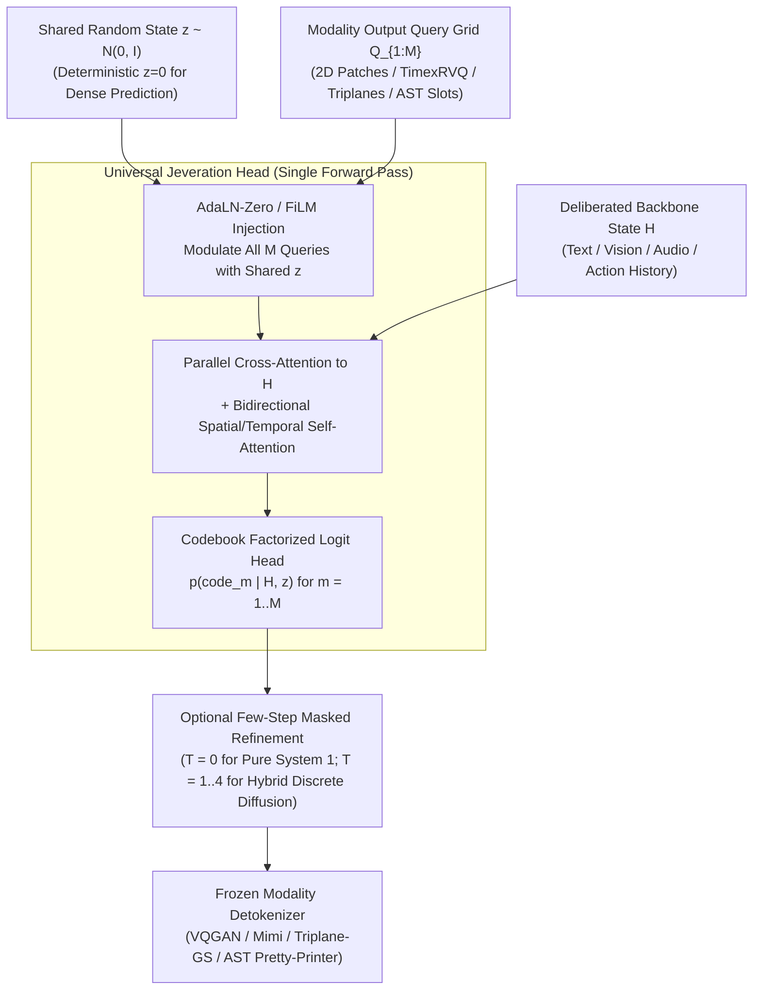

# 02 — Axis B: Cross-Modal Universal *Jeveration* (Single-Pass Generation Across All Modalities)

## 1. Generalizing the *Jeveration* Discovery

In **Jeveration** (*"Jeveration: System One Models Now Generate"*, Liu et al., NUS, Nov 2026 — `arXiv:2611.24738`), the authors cracked the fundamental barrier of non-autoregressive single-pass generation:

> **The Parallel Incoherence Problem:** When a conditioning input $\mathbf{c}$ (e.g., a text prompt, an observation, or an audio cue) admits *many* valid outputs $\mathbf{y} \sim p(\mathbf{y} \mid \mathbf{c})$, predicting all output tokens $\mathbf{y}_1, \dots, \mathbf{y}_M$ independently in parallel yields the factorized marginal $\prod_m p(\mathbf{y}_m \mid \mathbf{c})$, which blurs or mixes incompatible modes into incoherent garbage.

Jeveration's solution is extraordinarily general:
1. **Shared Random State ($\mathbf{z}$):** Draw a single global stochastic latent $\mathbf{z} \sim \mathcal{N}(\mathbf{0}, \mathbf{I}_{d_z})$ and broadcast it to **every** parallel output query position $m \in \{1, \dots, M\}$. Conditioning on $\mathbf{z}$ turns the multimodal marginal into a near-deterministic conditional $p(\mathbf{y}_{1:M} \mid \mathbf{c}, \mathbf{z}) \approx \prod_{m=1}^M p(\mathbf{y}_m \mid \mathbf{c}, \mathbf{z})$ so all parallel positions agree on **one globally coherent sample**.
2. **Discrete Codebook Bottleneck (Preventing $\mathbf{z}$-Collapse):** Naive regression against raw pixels/waveforms causes the network to ignore $\mathbf{z}$ and collapse to the conditional mean. Instead, Jeveration learns a structured distribution over **discrete latent codes** $\mathbf{c}_{1:M} \in \{1, \dots, V\}^M$ produced by a pretrained discrete tokenizer (VQ-VAE / FSQ / RVQ), with a variational/consistency latent encoder $q_\phi(\mathbf{z} \mid \mathbf{c}_{1:M}, \mathbf{H})$ during training that forces $\mathbf{z}$ to carry the global mode-selection bits (layout, lighting, timbre, trajectory branch, phrasing).

---

## 2. The Universal Jeveration Head (UJH)

In **OmniJev**, we elevate Jeveration from an image-only head into a **Universal Jeveration Head (UJH)** that attaches to the exact same deliberated backbone state $\mathbf{H}$ and works identically across **Images, Dense Prediction, Video/World Models, Audio/Speech, 3D Assets, and Structured Code/ASTs**:

### Mathematical Formulation
Let $\mathbf{Q}^{(0)} \in \mathbb{R}^{B \times M \times D}$ be the $M$ modality-specific output slot queries (e.g., $32 \times 32 = 1024$ image patch queries, or $T_a \times L_{\text{rvq}}$ audio code queries). Let $\mathbf{u} = \text{MLP}_z(\mathbf{z}) \in \mathbb{R}^{B \times D}$ be the projected shared random state (with $\mathbf{z} = \mathbf{0}$ for deterministic tasks like depth estimation or segmentation).

Each of the $L_{\text{ujh}}$ lightweight Jeveration transformer blocks ($L_{\text{ujh}} \in \{4, 6, 8\}$) applies **AdaLN-Zero** conditioning so $\mathbf{z}$ globally coordinates every query:
$$\tilde{\mathbf{Q}} = \mathbf{Q} + \alpha_1(\mathbf{u}) \odot \text{SelfAttn}_{\text{bidir}}\!\Big((1 + \gamma_1(\mathbf{u})) \odot \text{LN}(\mathbf{Q}) + \beta_1(\mathbf{u})\Big)$$
$$\mathbf{Q}' = \tilde{\mathbf{Q}} + \alpha_2(\mathbf{u}) \odot \text{CrossAttn}(\tilde{\mathbf{Q}}, \mathbf{H}) + \alpha_3(\mathbf{u}) \odot \text{FFN}\!\Big((1 + \gamma_3(\mathbf{u})) \odot \text{LN}(\tilde{\mathbf{Q}}) + \beta_3(\mathbf{u})\Big)$$
Finally, parallel codebook logits are emitted in one shot:
$$\mathbf{L}_m = \mathbf{W}_{\text{code}}^{(g(m))} \mathbf{Q}'_m \in \mathbb{R}^{V_{g(m)}}, \qquad \hat{c}_m = \arg\max_v \mathbf{L}_{m,v} \quad (\text{or low-temp sampling})$$
where $g(m)$ indexes the codebook group (e.g., RVQ hierarchy level $1\dots 8$ in audio, or single codebook in vision).

### Training Objective (Anti-Collapse Variational + Consistency Distillation)
To ensure $\mathbf{z}$ is **never ignored** and every $\mathbf{z} \sim \mathcal{N}(\mathbf{0}, \mathbf{I})$ decodes to a crisp, globally coherent output:
1. **Posterior Code-Conditioned Encoder $q_\phi(\mathbf{z} \mid \mathbf{c}_{1:M}, \mathbf{H})$:** During training, a lightweight permutation-pooled encoder sees the ground-truth discrete codes $\mathbf{c}_{1:M}$ and produces $\mathcal{N}(\boldsymbol{\mu}_\phi, \text{diag}(\boldsymbol{\sigma}_\phi^2))$, trained with a **free-bits $\beta$-KL constraint** so $\mathbf{z}$ encodes exact global mode entropy without posterior collapse:
   $$\mathcal{L}_{\text{UJ}} = \sum_{m=1}^M \text{CE}\!\left(\mathbf{L}_m(\mathbf{H}, \mathbf{z}_{\text{post}}),\, c_m^*\right) + \beta \max\!\left(\lambda_{\text{fb}},\, D_{\text{KL}}\!\left(q_\phi(\mathbf{z}\mid \mathbf{c}^*, \mathbf{H}) \,\|\, \mathcal{N}(\mathbf{0}, \mathbf{I})\right)\right)$$
2. **Prior-Sample Consistency / Adversarial Feature Matching:** On prior samples $\mathbf{z}_{\text{prior}} \sim \mathcal{N}(\mathbf{0}, \mathbf{I})$, an auxiliary frozen teacher / discriminator (or score-distillation VSD loss from a slow diffusion teacher) matches the joint code distribution so prior samples are indistinguishable from posterior reconstructions.
3. **Deterministic Task Flag (`deterministic=True`):** For dense prediction (depth, surface normals, semantic segmentation, optical flow), $\mathbf{z}$ is clamped to $\mathbf{0}$ and $\mathcal{L}_{\text{KL}} = 0$, collapsing UJH cleanly into a deterministic single-pass dense predictor.

---

## 3. Modality-by-Modality Concrete Realizations

| Modality | Output Query Grid $M$ | Discrete Tokenizer / Detokenizer | Shared $\mathbf{z}$ Role | Target Single-Pass Latency (H200 / Edge) |
| :--- | :--- | :--- | :--- | :--- |
| **B1. Image Gen & Editing (T2I / I2I)** | $32 \times 32 = 1024$ (for $512^2$) or $64 \times 64$ ($1024^2$) | FSQ / LlamaGen / Cosmos-Tokenizer-DI16x16 ($V=16384$) | Global composition, pose, lighting, palette | **~65–80 ms** (H200), ~180 ms (RTX 4090) |
| **B1b. Dense Prediction** | $32 \times 32$ or $64 \times 64$ spatial grid | Quantized Depth / Surface Normal / Optical Flow / Seg codes ($\mathbf{z}=\mathbf{0}$) | Disabled ($\mathbf{z}=\mathbf{0}$, deterministic) | **~35–55 ms** (H200) |
| **B2. Interactive Video / World Models** | $K_f \times H_v \times W_v$ (e.g., $1\text{–}4$ latent frames $\times 16 \times 24$) | Cosmos-DV / Genie-style Spatio-Temporal VQ Tokenizer | Stochastic environment events, NPC behavior, camera/physics micro-branches | **~25–60 ms/frame (16–40 FPS)** interactive! |
| **B3. Audio / Speech / SFX** | $T_a \times L_{\text{rvq}}$ (e.g., 12.5 Hz $\times$ 8 RVQ levels; 1s = 100 tokens) | Mimi / EnCodec / SNAC Residual Vector Quantizer | Prosody, speaker timbre variation, acoustic ambience | **~15–30 ms per 1–2s audio chunk** (faster than human speech onset!) |
| **B4. 3D & Spatial Assets** | $3 \times (16 \times 16) = 768$ Triplane codes or $512$ Latent GS tokens | Triplane-VQ / 3D Gaussian-Splat VQ-VAE (TRELLIS/MeshAnything-style) | Back-view completion, fine geometry & material variation | **~70–110 ms** for a full 3D object |
| **B5. Structured Code / Text AST Filling** | $M_{\text{holes}}$ typed AST slot queries + grammar mask | Vocabulary restricted per AST node type (e.g., identifier, literal, operator) | Implementation style / variable naming consistency across correlated holes | **~15–40 ms** (1 pass) or **~60 ms** ($T=2\text{–}4$ masked refinement passes) |

---

### Deep Technical Notes on the Hardest Cross-Modal Extensions

#### B2. Interactive Single-Pass World Models (15–60 FPS Neural Simulators)
Unlike diffusion video models that require 20–50 denoising steps per frame, **OmniJev-World** treats interactive simulation as a **streaming single-pass Jeveration loop**:
1. **Input State:** Persistent streaming recurrent state $\mathbf{S}_{t-1}$ (from Gated DeltaNet) + recent $W$ sliding-window visual frames + discrete/continuous **Action Token** $a_t$ (from a human controller or **Jev-VLA** in Axis C!).
2. **Next-Frame Parallel Decision:** Conditioned on $(\mathbf{H}_t, a_t, \mathbf{z}_t)$, UJH predicts all spatial latent codes of frame $t+1$ (or a 4-frame latent video chunk) in **one single forward pass**.
3. **Drift Control Without Diffusion Overhead:**
   - **Noise-Augmented Context Conditioning:** During training, past input frames receive random code corruption (5–15% token masking) so the single-pass predictor learns to self-heal accumulated rollout drift.
   - **Temporal $\mathbf{z}$-Persistence:** Global scene identity uses a persistent seed $\mathbf{z}_{\text{scene}}$ while per-step stochasticity uses an AR(1) innovations process $\mathbf{z}_t = \rho \mathbf{z}_{t-1} + \sqrt{1 - \rho^2}\boldsymbol{\epsilon}_t$, preventing frame-to-frame flicker.

#### B3. Hierarchical Parallel RVQ Audio Generation
In RVQ audio codecs (like Mimi or SNAC), fine acoustic levels $l = 2\dots 8$ depend on coarse semantic level $l = 1$. Predicting all 8 levels naively in parallel degrades fidelity. OmniJev solves this inside a **single macro-pass** using **Cascaded Sub-Pass Conditioning**:
- The heavy backbone encodes text/context **once** ($\mathbf{H}$).
- UJH predicts Level-1 semantic codes in parallel conditioned on $(\mathbf{H}, \mathbf{z})$; embeds the predicted Level-1 codes; and runs a tiny 2-layer Acoustic Depth MLP/Transformer (~1.5 ms) over levels $2\dots 8$ in parallel across all time steps. Total latency remains **<30 ms** for a 2-second speech/SFX segment while preserving full studio fidelity.

#### B5. Structured Text / Code AST Filling + Few-Step Discrete Diffusion Hybrid
Pure single-pass parallel text generation struggles with long open-ended prose, so OmniJev draws a crisp engineering boundary:
- **Pure System 1 ($T=1$ pass):** Filling typed AST holes, SQL templates, config parameters, and structured JSON slots where grammar constraints mask invalid vocabulary tokens at every slot $m$ ($\mathbf{L}_{m,v} = -\infty$ for grammar-invalid tokens $v$).
- **Hybrid System 1.5 ($T \in \{2, 4\}$ Masked Discrete Diffusion Refinement):** For medium-length structured blocks (e.g., 32–128 tokens of code patches or structured summaries), UJH runs **confidence-guided unmasking** (inspired by MaskGIT / MDLM / LLaDA):
  1. Pass 1 predicts all $M$ slots conditioned on $(\mathbf{H}, \mathbf{z})$.
  2. High-confidence tokens ($p > \tau_t$) are locked in; low-confidence tokens stay `[MASK]` and are fed back through the lightweight UJH decoder only (backbone $\mathbf{H}$ stays frozen & cached!).
  3. After $T \in \{2, 4\}$ micro-passes (~15 ms each), all slots resolve—giving 10×–25× speedup over autoregressive decoding while strictly enforcing grammar/AST validity.
- **System 2 Escalation:** Open-ended multi-page essays or open-ended architectural code synthesis escalates cleanly to a generative LLM via Axis D's router.
