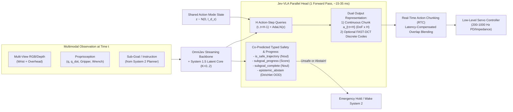
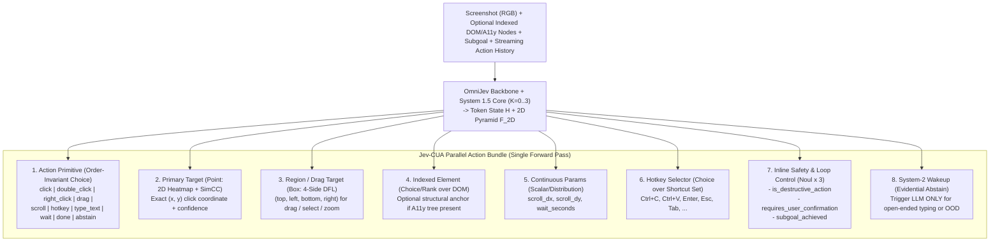
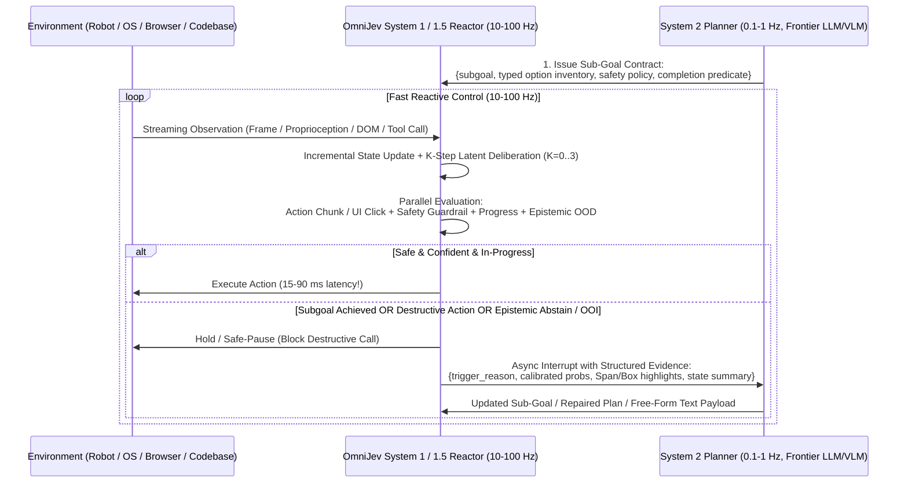

# 03 — Axis C (Deep Dive): Embodied Control, Single-Pass VLA Action Chunking, Computer-Use Agents, & Guardrails

> **Core Thesis for Axis C:** Embodied robots, real-time simulations, and GUI computer-use agents fail under autoregressive LLMs for two coupled reasons: **(1) the latency ceiling** (1–5 Hz text decoding causes physical instability and unusable UI lag) and **(2) the grounding/mode-averaging gap** (L1 regression averages bimodal paths into collisions, while free-form text actions break schemas). By uniting **Jev's typed parallel primitives**, **Jeveration's shared random state**, and **System 1.5 latent deliberation**, OmniJev enables **10–100 Hz globally coherent, calibrated, safety-verified control**.

---

## 1. Jev-VLA: Single-Pass Multimodal Action Chunking with Shared Random State

### 1.1 Why Existing Fast VLAs Still Face a Trilemma
Recent VLA milestones expose an unsolved trilemma:
1. **Autoregressive VLAs (OpenVLA, RT-2, FAST-AR):** Expressive multimodal distributions via discrete tokens, *but* slow token-by-token decoding (3–8 Hz).
2. **Parallel L1 Regression VLAs (OpenVLA-OFT):** Huge speedup (26×–50×, 25–100 Hz) via single-pass parallel action chunking, *but* L1/L2 regression minimizes conditional expectation/median—**collapsing bimodal trajectories**. If a robot can go *left* or *right* around an obstacle, averaging the two trajectories drives straight into the obstacle!
3. **Diffusion / Flow-Matching VLAs ($\pi_0$, $\pi_{0.5}$, Diffusion Policy):** Captures multimodal trajectories beautifully, *but* requires 5–20 iterative ODE/SDE denoising steps per chunk, inflating edge latency and power draw.

### 1.2 The OmniJev Solution: *Jeveration-for-Actions* (Single-Pass Stochastic Action Chunking)

**Jev-VLA** breaks the trilemma by transferring Jeveration's **Shared Random State ($\mathbf{z}$)** directly into a parallel action-chunk head:

#### Mathematical Formulation
Given deliberated observation state $\mathbf{H}_t$, proprioceptive skip vector $\mathbf{s}_t \in \mathbb{R}^{d_p}$, and a shared mode latent $\mathbf{z} \sim \mathcal{N}(\mathbf{0}, \mathbf{I}_{d_z})$:
1. Initialize $H$ temporal action queries $\mathbf{A}^{(0)} = [\mathbf{p}_0, \dots, \mathbf{p}_{H-1}] + \text{MLP}_{\text{prop}}(\mathbf{s}_t) \in \mathbb{R}^{H \times D}$ (typical horizon $H \in \{8, 16, 32, 50\}$ steps = 0.3–1.0 seconds).
2. Modulate all $H$ queries jointly via **AdaLN-Zero** using $\mathbf{u} = \text{MLP}_z(\mathbf{z})$ and run $L_a \in \{2, 4\}$ bidirectional cross-attention + temporal self-attention layers over $\mathbf{H}_t$.
3. Decode **two co-trained heads** (borrowing $\pi_{0.5}$'s co-training insight):
   - **Continuous Trajectory Chunk:** $\hat{\mathbf{a}}_{t:t+H} = \text{MLP}_{\text{act}}(\mathbf{A}') \in \mathbb{R}^{H \times D_{\text{act}}}$ (end-effector pose delta / joint targets + gripper open/close).
   - **Auxiliary FAST-DCT Discrete Action Codes:** $\mathbf{L}^{\text{fast}}_{1:M_a}$ predicting compressed DCT frequency tokens (used during training for representation richness and optional discrete verification).
4. **Why it NEVER mode-averages:** During training, a **Trajectory Mode Posterior Encoder** $q_\phi(\mathbf{z} \mid \mathbf{a}^*_{t:t+H}, \mathbf{H}_t)$ encodes which branch of the expert demonstration was taken (e.g., left-bypass vs. right-bypass, overhand vs. side grasp) into $\mathbf{z}$, paired with **1-Step Consistency / Rectified-Flow Distillation** from a teacher flow-matching policy:
   $$\mathcal{L}_{\text{VLA}} = \underbrace{\|\hat{\mathbf{a}}(\mathbf{H}_t, \mathbf{z}_{\text{post}}) - \mathbf{a}^*\|_1}_{\text{Conditional Trajectory Accuracy}} + \underbrace{\lambda_{\text{smooth}} \|\Delta^2 \hat{\mathbf{a}}\|_2^2}_{\text{Jerk Minimization}} + \underbrace{\beta \max(\lambda_{\text{fb}}, D_{\text{KL}}(q_\phi \| \mathcal{N}(0, I)))}_{\text{Anti-Collapse Mode Capacity}} + \underbrace{\lambda_{\text{fast}} \mathcal{L}_{\text{CE}}^{\text{FAST}}}_{\text{Discrete Co-Training}} + \underbrace{\lambda_{\text{distill}} \mathcal{L}_{\text{1-step-FM}}}_{\text{Prior Sample Sharpness}}$$
   At test time, drawing $\mathbf{z} \sim \mathcal{N}(\mathbf{0}, \mathbf{I})$ commits **all $H$ steps of the chunk** to one crisp, dynamically feasible mode in **a single forward pass**!

5. **Optional Best-of-$B_z$ Safety Reranking (Zero Backbone Overhead!):** Because the heavy vision-language backbone runs **once** to produce $\mathbf{H}_t$, we can batch $B_z = 4$ or $8$ random draws $\{\mathbf{z}^{(1)}, \dots, \mathbf{z}^{(B_z)}\}$ through ONLY the tiny 2–4 layer action head (~2 ms total!), score each candidate chunk with the co-predicted `is_safe_trajectory` (`Noul`) + `task_progress` (`Score`) + collision checker, and execute the highest-utility safe trajectory!

### 1.3 Real-Time Action Chunking (RTC) & Asynchronous Continuity
Physical robots cannot freeze while waiting 25 ms for the next inference pass. OmniJev implements **Latency-Compensated Asynchronous RTC**:
- Suppose chunk $\mathbf{a}^{(k)}$ of horizon $H$ starts executing at step $t_0$.
- At step $t_0 + d_{\text{exec}}$ (where $d_{\text{exec}} < H - d_{\text{lat}}$), OmniJev launches inference for chunk $\mathbf{a}^{(k+1)}$ while the servo continues executing steps $t_0 + d_{\text{exec}} \dots t_0 + d_{\text{exec}} + d_{\text{lat}}$ of $\mathbf{a}^{(k)}$.
- **Prefix-Conditioned Continuity:** The already-committed in-flight actions $\mathbf{a}^{(k)}_{t_{\text{now}} : t_{\text{now}}+d_{\text{lat}}}$ are passed as prefix tokens into the Jev-VLA head (so $\mathbf{a}^{(k+1)}$ is physically consistent with where the arm *will actually be* when the new chunk takes over!).
- **Smooth Overlap Blending:** Over overlap window $W_{\text{blend}}$ steps, actions blend via raised-cosine weights $w_j = \frac{1}{2}(1 - \cos(\pi \frac{j+1}{W_{\text{blend}}+1}))$:
  $$\mathbf{a}^{\text{exec}}_j = (1 - w_j)\,\mathbf{a}^{(k)}_j + w_j\,\mathbf{a}^{(k+1)}_j$$
- **Control Frequency Budget:** With `OmniJev-Edge (3B)` on Jetson Orin AGX / RTX 4090, backbone + VLA pass takes **18–35 ms** ($\approx 30\text{–}55$ Hz chunk updates), driving a 200–1000 Hz low-level impedance controller smoothly with zero jerk.

---

## 2. Jev-CUA: Single-Pass Joint Action + Spatial Grounding for Computer-Use & Browser Agents

### 2.1 Why Current Computer-Use Agents Are Slow and Fragile
Existing GUI agents (even strong native VLM models like UI-TARS or Claude Computer Use) spend **1–6 seconds per click** because they autoregressively emit thought strings, JSON keys, action names, and coordinate digit tokens—and still occasionally hallucinate malformed coordinates or click dangerous buttons.

### 2.2 The Jev-CUA Unified Single-Pass Decision Head
**Jev-CUA** consumes `(raw_screenshot, optional_DOM/A11y_tree, subgoal, action_history_state)` and emits the **entire typed computer-use action bundle in ONE parallel pass (~40–90 ms)**:

### 2.3 Action-Conditioned Spatial Cross-Coupling (Zero Extra Backbone Pass!)
Notice a subtle dependency: the `(x, y)` click target for `scroll` (e.g., inside a scrollable pane) can differ from the `(x, y)` target for `click` (e.g., on the "Submit" button). Jev-CUA handles this cleanly in **<2 ms** without re-running the backbone:
1. First, the lightweight `ACT` head outputs the action probability distribution $\mathbf{p}_{\text{act}}$ and winning action embedding $\mathbf{e}_{\hat{a}}$.
2. The spatial query $\mathbf{q}_{\text{spatial}} = \mathbf{q}_{\text{task}} + \mathbf{W}_{\text{act}} \mathbf{e}_{\hat{a}}$ modulates $\mathbf{F}_{\text{2D}}$ via FiLM before decoding `Point` and `Box`.
3. **Coarse-to-Fine 2-Pass Zoom (via Composable Decision Graph, Axis D):** When the `Point` head reports high spatial entropy or the target lies in a dense 4K toolbar (`max_peak_prob < 0.75`), the runtime automatically triggers a **micro-pass 2**: it crops the image around pass-1's predicted `Box` (expanded by 1.5×), re-encodes only the cropped $224\times 224$ patch (~15 ms), and re-runs `Point` to achieve **<3 px precision** on 4K displays!
4. **Hybrid DOM + Pixel Fusion:** When browser DOM or OS accessibility trees are available, each interactive element $i$ is represented by its `(role, text, bbox)` token. The `DOM` head scores all elements in parallel (`Choice`/`Rank`), and its winning bounding box acts as a soft spatial prior fused with the pixel `Point` heatmap—delivering the speed & exactness of DOM selectors with pure-pixel fallback for Canvas/WebGL/PDF/remote desktop apps.
5. **Selective Generative Wakeup:** Over 80% of real GUI trajectories consist of navigation, clicking, scrolling, selecting dropdowns, and pressing hotkeys. Jev-CUA executes all of these at **10–25 actions/sec** with zero text generation, waking the generative System-2 LLM *only* when `action == type_text` (to draft an email/query) or when `WAKE` fires on an ambiguous/unexpected UI state.

---

## 3. Hierarchical Dual-Rate Control: Slow Planner (System 2) + Fast Reactor (OmniJev System 1 / 1.5)

Long-horizon tasks (cleaning a kitchen, filing a 15-step tax form, debugging a repository) fail under pure System-1 models because small local errors compound over 50–500 steps (confirmed by $\tau$-bench results in **JEVal**, `arXiv:2610.03935`). OmniJev embeds inside a formal **Dual-Rate Hierarchical Control Loop**:

### Why This Solves JEVal's Long-Horizon Error Accumulation
1. **Bounded Sub-Goal Horizons:** OmniJev only executes locally verifiable sub-goals (5–30 steps) rather than 200-step open-ended missions.
2. **Closed-Loop Progress & Drift Monitors:** Every reactive pass co-predicts `subgoal_progress` (`Score`) and `state_anomaly` (`Noul`). If progress stalls for $N_{\text{stall}}$ ticks or anomaly probability spikes, OmniJev triggers an early replanning interrupt to System 2 *before* compounding errors become irreversible.
3. **Asymmetric Compute Economics:** System 2 runs for ~2–5% of steps (handling strategy, recovery, and prose); OmniJev handles 95–98% of steps at 1–5% of the cost and 30×–100× the frequency.

---

## 4. Inline Code, Tool-Call, & Physical Safety Guardrails (Zero-Hallucination Verifiers)

Before any coding agent executes a shell command, SQL query, file edit, or robot executes an action chunk, an inline **OmniJev Guardrail Head** screens the proposed action in **<20 ms** in one parallel pass:

| Guardrail Primitive | What It Outputs | Downstream Deterministic Software Branch |
| :--- | :--- | :--- |
| **`is_policy_violation` (`Noul`)** | Calibrated probability $p_{\text{viol}} \in [0, 1]$ + epistemic uncertainty $u_{\text{epi}}$ | Block if $p_{\text{viol}} > \tau_{\text{block}}$; ask human if $u_{\text{epi}} > \tau_{\text{ask}}$ |
| **`risk_category` (`Choice`)** | `{safe, credential_leak, destructive_fs, network_exfil, prompt_injection, privilege_esc, physical_collision, OOI}` | Routes directly to specific remediation handler |
| **`severity` (`Score`)** | Ordinal severity `0..4` (`info` $\to$ `critical`) | Determines logging vs. sandbox vs. hard block |
| **`offending_span` (`Span`)** | Exact `[start, end]` character/token span inside the bash command, diff, or SQL | Highlights the exact dangerous flag (e.g., `rm -rf /` or `DROP TABLE`) in the audit UI with zero hallucination! |
| **`unsafe_region` (`Box`)** | *(Robotics/UI)* Exact image region causing hazard (e.g., human hand in workspace, "Delete Account" button) | Visual overlay for operator approval or spatial exclusion zone |

---

## 5. Control Latency & Frequency Targets Across Axis C Domains

| Axis C Domain | Recommended Model Tier | Deliberation Depth $K$ | End-to-End Pass Latency | Effective Control Rate |
| :--- | :--- | :--- | :--- | :--- |
| **High-Rate Drone / Quadruped / Dexterous Hand** | `OmniJev-Nano (0.6B–1.5B)` INT4/FP8 | $K = 0$ | **6–12 ms** | **80–150 Hz** (chunked) |
| **Bimanual Manipulation (ALOHA / Household VLA)** | `OmniJev-Edge (3B–4B)` FP8 | $K \in \{0, 1\}$ | **18–35 ms** | **30–55 Hz** chunk updates ($\to$ 500 Hz servo via RTC) |
| **Desktop / Browser Computer-Use Agent (Jev-CUA)** | `OmniJev-Edge (4B)` or `OmniJev-Base (8B)` | $K \in \{0, 1, 2\}$ | **35–85 ms** | **12–28 actions/sec** |
| **Real-Time Game / Sim Agent (Doom / Minecraft / StarCraft)** | `OmniJev-Nano (1.5B)` | $K = 0$ | **8–15 ms** | **60+ FPS** |
| **Coding Agent Inline Security & Loop-Stop Hook** | `OmniJev-Edge (4B)` | $K \in \{0, 2\}$ | **12–30 ms** | Real-time pre-tool-call gating |
