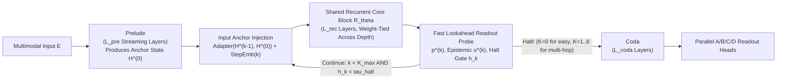
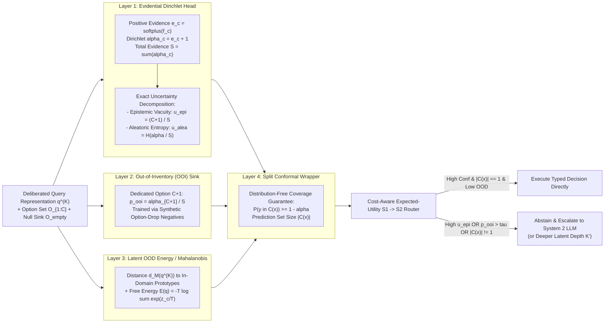
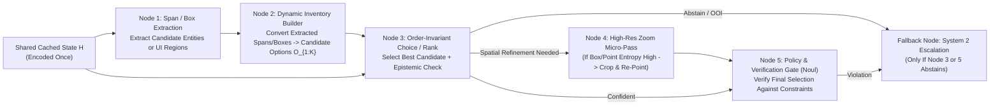

# 04 — Axis D (Deep Dive): System 1.5 Latent Deliberation, Epistemic Abstention, Debiasing, Composable Graphs, & Streaming State

> **Core Thesis for Axis D:** Pure single-pass System One models (like Jev 1.x) hit five documented walls across **JEVal** (`arXiv:2610.03935`), **JevBench-hard**, **Jev-ToM** (`arXiv:2610.18610`), and **Bias Studies** (`arXiv:2610.19619`):
> 1. **Multi-hop / cross-record reasoning failure** (cannot combine disjoint facts in one static pass).
> 2. **Overconfident guessing & Out-of-Inventory (OOI) blindness** (cannot abstain reliably when no supplied option is valid or the input is OOD).
> 3. **Option-order & framing bias** (probabilities shift when choices are reordered or rephrased).
> 4. **Rigid single-shot schemas** (cannot zoom in or dynamically build step-2 options from step-1 findings).
> 5. **Static context re-prefill ceiling** (32K token window re-encoded from scratch on every turn rather than streaming continuously).
>
> OmniJev solves **all five walls architecturally**—creating a **"System 1.5"** bridge that retains zero-text-token speed while knowing when to deliberate latently and when to wake System 2.

---

## 1. System 1.5: Fixed-Depth & Adaptive Recurrent Latent Deliberation

### 1.1 Why "Thinking in Text" Breaks the Jev Contract
*Thinking Jev* (`arXiv:2610.02076`) recovers multi-hop reasoning by letting an LLM emit Chain-of-Thought (CoT) tokens before reading out the decision logit. While accurate, emitting 200–1,000 reasoning tokens destroys Jev's core advantages: latency jumps from **40 ms $\to$ 3,000+ ms**, GPU memory bandwidth saturates on autoregressive decoding, and edge control loops break.

### 1.2 Recurrent Depth Latent Core (Huginn + TaH2 Inspired)
Drawing on **Huginn** (depth-recurrent transformers) and **TaH2** (*Adaptive Looped Transformers*, late 2026), OmniJev decomposes its backbone into three parts:

$$\mathbf{H}^{(0)} = \underbrace{\text{Prelude}(\mathbf{E})}_{\text{Encode Once (}L_{\text{pre}}\text{ layers)}} \;\longrightarrow\; \mathbf{H}^{(k)} = \underbrace{\mathcal{R}_\theta\!\left(\mathbf{H}^{(k-1)},\, \mathbf{H}^{(0)},\, \mathbf{e}_{\text{step}}(k)\right)}_{\text{Recurrent Core looped } k = 1 \dots K} \;\longrightarrow\; \mathbf{H}^{\text{out}} = \underbrace{\text{Coda}(\mathbf{H}^{(K)})}_{\text{Readout Adapter (}L_{\text{coda}}\text{ layers)}}$$

### Key Architectural Mechanics
1. **Input-Anchored Residual Injection (Preventing Representation Drift):** At every latent loop $k$, the recurrent block receives both the evolving latent state $\mathbf{H}^{(k-1)}$ and the immutable encoded anchor $\mathbf{H}^{(0)}$ via a gated fusion:
   $$\tilde{\mathbf{H}}^{(k-1)} = \text{RMSNorm}\!\Big(\mathbf{H}^{(k-1)} + \sigma(\mathbf{W}_g [\mathbf{H}^{(k-1)}; \mathbf{H}^{(0)}]) \odot \mathbf{W}_{\text{in}} \mathbf{H}^{(0)} + \mathbf{e}_{\text{step}}(k)\Big)$$
   This guarantees the model never forgets raw evidence tokens even after $K = 8\text{–}16$ latent hops!
2. **Adaptive Halting Gate (Zero-Waste Compute Allocation):**
   At each step $k \in \{0, 1, \dots, K_{\max}\}$, a lightweight halting decider computes:
   - **Prediction Stability Signal:** $s_k = D_{\text{KL}}\!\left(p^{(k)} \,\|\, p^{(k-1)}\right)$ (for $k \ge 1$) measuring whether the tentative decision distribution is still shifting.
   - **Learned Lookahead Halting Probability:** $h_k = \sigma\!\left(\text{MLP}_{\text{halt}}([\mathbf{q}^{(k)};\, u_{\text{epi}}^{(k)};\, s_k;\, k / K_{\max}])\right)$ trained via **TaH2 Lookahead Depth Supervision** (target $h_k^* = 1$ at the earliest step $k$ where the model's prediction matches the final $K_{\max}$ answer with calibrated confidence).
   - **Inference Execution Rule:**
     - **Pure System 1 ($K = 0$):** Halts immediately after Prelude $\to$ Coda (~15–30 ms). Handles ~70–85% of routine classification, routing, and reflex control queries.
     - **System 1.5 ($K \in \{1, \dots, K_{\max}\}$):** Loops only for multi-hop logic, cross-record synthesis, Theory-of-Mind (`Jev-ToM`), or complex spatial disambiguation—paying only $O(K \cdot L_{\text{rec}})$ parallel prefill-like FLOPs (100% Tensor-Core bound, **zero sequential token decoding**!).
3. **Training via *Reasoning-to-Latent-Readout Self-Distillation*:**
   Extending **SII-Decision** (`arXiv:2610.03935`), we generate rich System-2 CoT reasoning traces from a frontier teacher on multi-hop, mathematical, scientific, and agentic datasets, recording the teacher's intermediate sub-conclusions and final calibrated probability distributions $\mathbf{p}^*_{\text{S2}}$. We supervise OmniJev's recurrent latent core using:
   - **Step-Weighted Proper Scoring Loss** across depths $k \in \{1,\dots,K_{\max}\}$ (progressively sharper weights for deeper $k$).
   - **Latent Trajectory Distillation:** Aligning intermediate latent states $\mathbf{H}^{(k)}$ (via linear probes) to the semantic embeddings of intermediate reasoning hops so each loop performs genuine multi-hop composition rather than idling.
   - **KL Anchor Loss** (`arXiv:2610.02076`) preserving general world representations of the pretrained backbone.

---

## 2. Native Epistemic Abstention, Out-of-Inventory (OOI) Detection, & System-1 $\to$ System-2 Routing

### 2.1 Fixing Overconfidence & The Out-of-Inventory Blind Spot
Standard softmax outputs $\mathbf{p} = \text{softmax}(\mathbf{z})$ conflate **aleatoric uncertainty** (genuine inherent ambiguity, e.g., an equally valid coin-flip option) with **epistemic uncertainty** (the model is out-of-distribution, lacks knowledge, or none of the supplied options are valid). Softmax *always* sums to 1 over the provided inventory, causing *JevBench-hard*'s forced-choice failures.

OmniJev introduces a **Four-Layer Calibrated Uncertainty & Abstention Stack**:

#### Layer 1: Evidential Dirichlet Parameterization
For any `Choice` ($C$ options + 1 OOI sink = $C+1$ classes) or `Noul` ($C=2$ Beta distribution), the head outputs non-negative evidence $\mathbf{e} \in \mathbb{R}_{\ge 0}^{C+1}$ defining a Dirichlet distribution $\text{Dir}(\mathbf{p} \mid \boldsymbol{\alpha})$ with $\boldsymbol{\alpha} = \mathbf{e} + \mathbf{1}$ and Dirichlet strength $S = \sum_{c=1}^{C+1} \alpha_c$:
- **Expected Probability:** $\hat{p}_c = \alpha_c / S$.
- **Epistemic Uncertainty (Vacuity):**
  $$u_{\text{epi}} = \frac{C + 1}{S} \in (0, 1]$$
  When the model has *no evidence* for any option ($\mathbf{e} \approx \mathbf{0}$), $S \approx C+1$ and $u_{\text{epi}} \to 1$!
- **Aleatoric Uncertainty (Expected Data Entropy):**
  $$u_{\text{alea}} = \mathbb{E}_{\mathbf{p} \sim \text{Dir}(\boldsymbol{\alpha})}[H(\mathbf{p})] = \sum_{c=1}^{C+1} \frac{\alpha_c}{S}\big(\psi(S+1) - \psi(\alpha_c + 1)\big)$$
  Crucially, if two options are *genuinely equally valid* (high evidence for both: $\alpha_1 = 50, \alpha_2 = 50$), $u_{\text{alea}}$ is high while $u_{\text{epi}}$ is **low**—telling downstream code *"this is a true tie, not ignorance"*. Conversely, on an unfamiliar domain ($\alpha_1 \approx 1.1, \alpha_2 \approx 1.0$), $u_{\text{epi}}$ spikes—triggering System-2 escalation!

#### Layer 2: Synthetic Out-of-Inventory (OOI) Training
During RLCD training, on 15–25% of training instances we **intentionally drop the true label** from the option inventory (or replace all options with plausible distractors) and set the ground-truth target to the dedicated **OOI Sink** ($c = C+1$). The model explicitly learns when *none* of the supplied choices fits the state.

#### Layer 3: Latent Feature-Space OOD Scoring
Because neural heads can extrapolate overconfidently far from the training manifold, OmniJev tracks class-agnostic **Mahalanobis / Cosine-Prototype distance** $d_{\text{OOD}}(\mathbf{q}^{(K)})$ against spherical prototypes stored from calibration data (only ~64 KB of memory!), fused into a normalized OOD score $s_{\text{ood}} \in [0, 1]$.

#### Layer 4: Finite-Sample Split Conformal Prediction Wrapper
Using a small held-out calibration set $\{(x_i, y_i)\}_{i=1}^{n_{\text{cal}}}$ ($n_{\text{cal}} \approx 500\text{–}2000$), we compute non-conformity scores $r_i = 1 - \hat{p}_{y_i}(x_i) + \lambda_{\text{epi}} u_{\text{epi}}(x_i) + \lambda_{\text{ood}} s_{\text{ood}}(x_i)$ and find the empirical $(1-\alpha)(1 + 1/n_{\text{cal}})$ quantile $\hat{q}_\alpha$. At inference time, the conformal prediction set is:
$$\mathcal{C}_\alpha(x) = \left\{ c \in \{1, \dots, C\} \;\middle|\; 1 - \hat{p}_c(x) + \lambda_{\text{epi}} u_{\text{epi}}(x) + \lambda_{\text{ood}} s_{\text{ood}}(x) \le \hat{q}_\alpha \right\}$$
By conformal theory, under exchangeability this guarantees $\mathbb{P}(y \in \mathcal{C}_\alpha(x)) \ge 1 - \alpha$ **regardless of model architecture**.
- $|\mathcal{C}_\alpha(x)| = 1$: Single certified answer $\to$ **Auto-execute!**
- $|\mathcal{C}_\alpha(x)| = 0$: Guaranteed OOI / OOD $\to$ **Abstain & Escalate!**
- $|\mathcal{C}_\alpha(x)| > 1$: Ambiguous among certified candidates $\to$ **Either step up latent depth $K \to K_{\max}$ or escalate to System 2 restricted to $\mathcal{C}_\alpha(x)$!**

#### Cost-Aware Expected-Utility Escalation Policy
Let $C_{\text{err}}$ be the domain error cost (e.g., high for `rm -rf`, low for ticket tagging), $C_{\text{S2}}$ be the latency/dollar cost of calling System 2, and $\hat{p}_{\text{err}}^{\text{S1}} = 1 - \max_c \hat{p}_c + \gamma u_{\text{epi}}$ be OmniJev's calibrated failure probability (vs. $\hat{p}_{\text{err}}^{\text{S2}}$ for System 2). Escalate to System 2 iff:
$$\left(\hat{p}_{\text{err}}^{\text{S1}} - \hat{p}_{\text{err}}^{\text{S2}}\right) \cdot C_{\text{err}} > C_{\text{S2}} \quad \text{OR} \quad p_{\text{ooi}} > \tau_{\text{ooi}} \quad \text{OR} \quad |\mathcal{C}_\alpha(x)| \ne 1$$
This yields a provably optimal **cost–accuracy Pareto frontier**, cutting System-2 calls by 80–95% while matching or beating System-2-only accuracy!

---

## 3. Structural Debiasing & Exact $O(1)$ Permutation / Framing Invariance

`arXiv:2610.19619` (*Are AI Decision Models Biased? A Case Study of Jev*) and **AnyJev** showed that prompt-concatenated decision models exhibit systematic option-order bias, label-token bias, and framing sensitivity. AnyJev mitigates order bias via **$K$-fold cyclic rotation averaging**, multiplying inference compute by $K$.

OmniJev achieves **exact $O(1)$ permutation invariance** in a **single pass** with zero rotation overhead:

1. **Isolated Option Encoding with Local RoPE Reset:** Options $\{o_1, \dots, o_C\}$ are NOT concatenated in one positional stream. Each option $o_c$ starts at position index `0` in its own block-diagonal causal/bidirectional attention lane attending only to `[shared state H, itself]`.
2. **Position-Free Set Self-Attention:** Option summaries $\{\mathbf{o}_1, \dots, \mathbf{o}_C\}$ interact via Multi-Head Self-Attention with **zero positional embeddings** (`RoPE disabled` on the option set axis). Because self-attention without positional bias is mathematically **permutation-equivariant**, swapping options $i \leftrightarrow j$ swaps outputs $\tilde{\mathbf{o}}_i \leftrightarrow \tilde{\mathbf{o}}_j$ identically!
3. **Prior-Centered / Token-Free Logits:** Because OmniJev scores options via continuous query–option bilinear compatibility rather than arbitrary alphabet tokens (`"A"`, `"B"`, `"C"`), **label-token prior bias disappears completely**.
4. **Framing-Invariance RLCD Objective:** During RLCD training, semantically equivalent paraphrases $(q, q')$ and polarity flips (*"Is this safe?"* vs. *"Is this unsafe?"*) are paired with a Jensen–Shannon Consistency Penalty:
   $$\mathcal{L}_{\text{calib}} = \mathcal{L}_{\text{Evid-NLL}} + \lambda_B \underbrace{\|\hat{\mathbf{p}} - \mathbf{y}\|_2^2}_{\text{Brier Proper Rule}} + \lambda_{\text{frame}} D_{\text{JS}}\!\big(\hat{\mathbf{p}}(q) \,\|\, \pi_{\text{flip}}(\hat{\mathbf{p}}(q'))\big) + \lambda_{\text{KL}} \mathcal{L}_{\text{Evid-KL}}$$
   guaranteeing proper-scoring-rule calibration AND logical consistency under reframing ($p(\text{safe}) + p(\text{unsafe}) \approx 1$).

---

## 4. Composable Decision Graphs (CDGs)

Single-shot schemas fail when downstream questions depend on upstream extractions or zoomed visual regions. OmniJev introduces **Composable Decision Graphs (CDGs)**—a lightweight typed DAG runtime that executes over a **shared cached backbone state**:

### Three Signature CDG Patterns
1. **Extract-Then-Decide (Dynamic Inventories):** Pass-1 `Span` extracts all candidate entities/drugs/clauses from a 20-page document $\to$ Pass-2 `Rank` / `Graph` / `Choice` evaluates relationships exclusively over those grounded spans (eliminating the fixed-inventory limitation *without* ever generating text!).
2. **Coarse-to-Fine Spatial Zoom:** Pass-1 `Box` locates a toolbar or surgical region on a 4K image $\to$ runtime crops the high-resolution patch $\to$ Pass-2 `Point` / `Mask` achieves sub-pixel accuracy at <25 ms extra cost.
3. **Self-Verifying Loop Control:** Pass-1 executes an action or structured AST fill $\to$ Pass-2 (`Noul` verifier) checks constraint satisfaction against cached $\mathbf{H}$ $\to$ branches deterministically to `accept`, `retry_with_new_z`, or `escalate_S2`.

---

## 5. Streaming Incremental Continuous State (Gated DeltaNet + SWA Hybrid)

Traditional Jev models have a static context window (e.g., 32K tokens) and must re-encode the state on every call—prohibitive for live video feeds, continuous voice streams, robot sensors, or 24/7 server telemetry.

OmniJev's backbone uses a **3:1 Interleaved Hybrid Architecture** inspired by **Gated DeltaNet / GDN-2** (ICLR 2025–2026) + **Sliding Window Attention (SWA)**:

- **3 out of every 4 layers: Gated DeltaNet (Continuous Recurrent Matrix Memory):**
  Maintains a fixed-size per-head state matrix $\mathbf{S}_t \in \mathbb{R}^{d_k \times d_v}$ updated in **$O(1)$ time and $O(1)$ memory** per incoming token/frame chunk:
  $$\mathbf{S}_t = \alpha_t \mathbf{S}_{t-1} \left(\mathbf{I} - \beta_t \mathbf{k}_t \mathbf{k}_t^\top\right) + \beta_t \mathbf{v}_t \mathbf{k}_t^\top, \qquad \mathbf{o}_t = \mathbf{S}_t^\top \mathbf{q}_t$$
  - $\alpha_t \in (0, 1)$: learned **decay gate** for bulk forgetting of stale scenes/logs.
  - $\beta_t \in (0, 1)$ + delta term $-\beta_t \mathbf{S}_{t-1}\mathbf{k}_t\mathbf{k}_t^\top + \beta_t \mathbf{v}_t\mathbf{k}_t^\top$: **surgical key-value overwrite** (e.g., updating `"object_location"` or `"user_cart_total"` cleanly without bloating context!).
- **1 out of every 4 layers: Sliding Window Attention (SWA, window $W = 2048\text{–}4096$):**
  Maintains a fixed-size ring-buffer KV cache for crisp local syntax, exact token-level `Span` extraction, and recent multi-frame visual correspondence.
- **Anytime Decision Readout:** Because $(\mathbf{S}_t, \text{KV}_{\text{SWA}})$ has strictly **constant $O(1)$ memory regardless of stream duration** (10 seconds or 10 hours!), any Axis A/B/C/D query can tap the live stream at time $t$ with **zero historical re-prefill**—processing only the new delta chunk $\Delta \mathbf{X}_t$ before reading out decisions in **<15 ms**!
